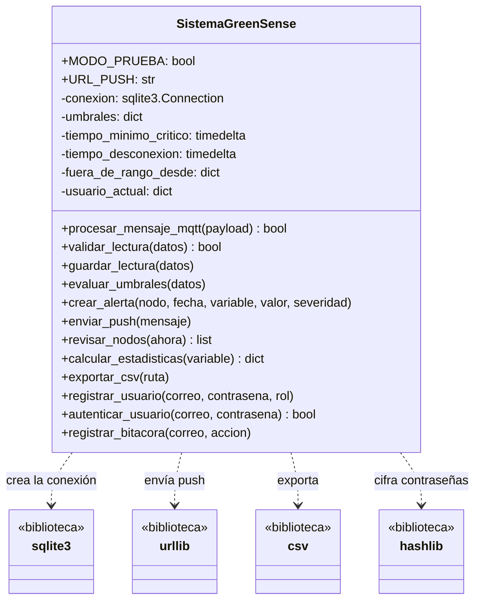
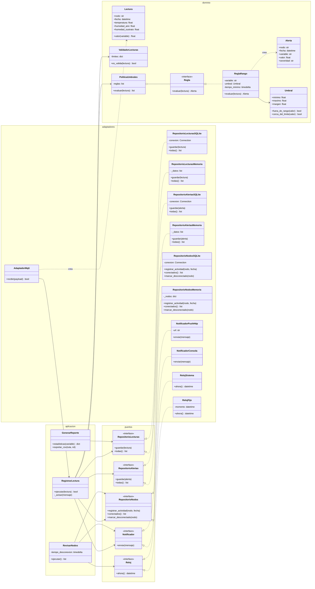
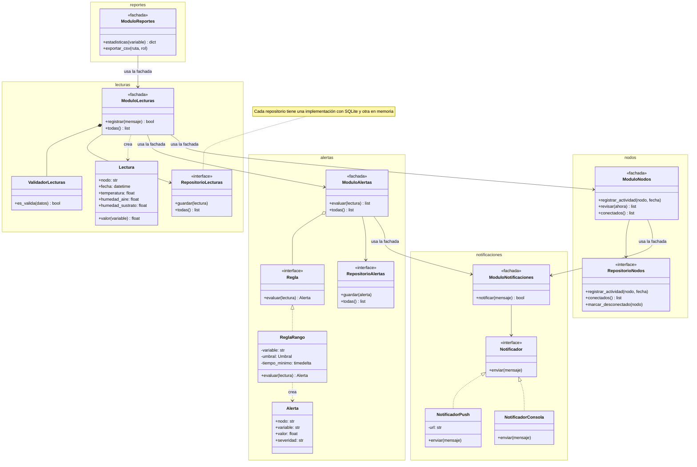

# GreenSense IoT: análisis y mejora del diseño

GreenSense IoT es un sistema de monitoreo ambiental y alertas para invernaderos. Un nodo con sensores mide la temperatura, la humedad del aire y la humedad del sustrato cada 60 segundos y envía las lecturas por MQTT a un servidor. El servidor valida y guarda las lecturas, las compara con los umbrales del cultivo y envía notificaciones push cuando una variable sale del rango adecuado.

Este repositorio contiene el análisis del diseño del servidor: una versión original con todas las responsabilidades en una sola clase y cuatro versiones mejoradas que aplican los principios SOLID con enfoques distintos.

## Estructura

```
greensense-diseno/
├── docs/
│   ├── requisitos.md          requisitos funcionales y no funcionales
│   └── analisis_original.md   responsabilidades, problemas, SOLID y diagrama
├── original/
│   ├── sistema_greensense.py  diseño original
│   └── tests/
└── versiones/
    ├── README.md              enfoques y contrato común
    ├── capas/
    ├── puertos/
    ├── eventos/
    └── modulos/
```

## Diseño original

La clase `SistemaGreenSense` recibe mensajes, valida, guarda en la base de datos, evalúa umbrales, genera alertas, envía notificaciones, revisa nodos, calcula estadísticas, exporta reportes y maneja usuarios. Tiene al menos seis motivos de cambio distintos y presenta duplicación, acoplamiento con la infraestructura y un error de confiabilidad: si falla el envío push, la alerta crítica se pierde.

El análisis completo y el diagrama están en [`docs/analisis_original.md`](docs/analisis_original.md).

## Versiones mejoradas

| Versión | Enfoque | Principio que destaca |
|---|---|---|
| [`capas`](versiones/capas) | Servicios, repositorios y notificadores | Responsabilidad única |
| [`puertos`](versiones/puertos) | Núcleo de reglas aislado con puertos y adaptadores | Inversión de dependencias |
| [`eventos`](versiones/eventos) | Eventos con reglas y canales como estrategias | Abierto/cerrado |
| [`modulos`](versiones/modulos) | Módulos por funcionalidad del negocio | Alta cohesión y segregación de interfaces |

Todas cumplen el mismo contrato de alcance y pruebas, descrito en [`versiones/README.md`](versiones/README.md).

## Diagramas de clases

Diagramas UML del diseño original y de las cuatro versiones mejoradas. En cada clase se muestran sus atributos y métodos, es decir, la responsabilidad que tiene. GitHub permite ampliar y desplazar cada diagrama.

Notación: `<|..` realización de una interfaz, `-->` asociación, `..>` dependencia, `o--` agregación y `*--` composición.

### Diseño original

Una sola clase con todas las responsabilidades y dependencias directas a la infraestructura.



### Versión de capas

Organiza las clases por tipo técnico: servicios que coordinan, reglas que deciden, repositorios que guardan y notificadores que avisan.

```mermaid
classDiagram
    direction TB
    class ServicioLecturas {
        -validador: ValidadorLecturas
        -repositorio_lecturas: RepositorioLecturas
        -repositorio_nodos: RepositorioNodos
        -evaluador: EvaluadorUmbrales
        -servicio_alertas: ServicioAlertas
        +procesar_mensaje(mensaje) bool
    }
    class ServicioAlertas {
        -repositorio_alertas: RepositorioAlertas
        -notificador: Notificador
        +registrar(alertas)
        -_avisar(mensaje)
    }
    class ServicioReportes {
        -repositorio_lecturas: RepositorioLecturas
        +estadisticas(variable) dict
        +exportar_csv(ruta, rol)
    }
    class MonitorNodos {
        -repositorio_nodos: RepositorioNodos
        -notificador: Notificador
        -tiempo_desconexion: timedelta
        +revisar(ahora) list
    }
    class ValidadorLecturas {
        -limites: dict
        +es_valida(datos) bool
    }
    class EvaluadorUmbrales {
        -umbrales: dict
        -tiempo_minimo: timedelta
        -reglas_adicionales: list
        +evaluar(lectura) list
        -_evaluar_variable(lectura, variable) Alerta
    }
    class ReglaAdicional {
        <<interface>>
        +evaluar(lectura) Alerta
    }
    class RepositorioLecturas {
        <<interface>>
        +guardar(lectura)
        +todas() list
    }
    class RepositorioAlertas {
        <<interface>>
        +guardar(alerta)
        +todas() list
    }
    class RepositorioNodos {
        <<interface>>
        +registrar_actividad(nodo, fecha)
        +conectados() list
        +marcar_desconectado(nodo)
    }
    class Notificador {
        <<interface>>
        +enviar(mensaje)
    }
    class RepositorioLecturasSQLite {
        -conexion: Connection
        +guardar(lectura)
        +todas() list
    }
    class RepositorioLecturasMemoria {
        -_lecturas: list
        +guardar(lectura)
        +todas() list
    }
    class RepositorioAlertasSQLite {
        -conexion: Connection
        +guardar(alerta)
        +todas() list
    }
    class RepositorioAlertasMemoria {
        -_alertas: list
        +guardar(alerta)
        +todas() list
    }
    class RepositorioNodosSQLite {
        -conexion: Connection
        +registrar_actividad(nodo, fecha)
        +conectados() list
        +marcar_desconectado(nodo)
    }
    class RepositorioNodosMemoria {
        -_nodos: dict
        +registrar_actividad(nodo, fecha)
        +conectados() list
        +marcar_desconectado(nodo)
    }
    class NotificadorPush {
        -url: str
        +enviar(mensaje)
    }
    class NotificadorConsola {
        +enviar(mensaje)
    }
    class Lectura {
        +nodo: str
        +fecha: datetime
        +temperatura: float
        +humedad_aire: float
        +humedad_sustrato: float
        +desde_dict(datos) Lectura
        +valor(variable) float
    }
    class Alerta {
        +nodo: str
        +fecha: datetime
        +variable: str
        +valor: float
        +severidad: str
        +descripcion: str
    }
    class Umbral {
        +minimo: float
        +maximo: float
        +margen: float
        +fuera_de_rango(valor) bool
        +cerca_del_limite(valor) bool
    }
    ServicioLecturas --> ValidadorLecturas
    ServicioLecturas --> EvaluadorUmbrales
    ServicioLecturas --> RepositorioLecturas
    ServicioLecturas --> RepositorioNodos
    ServicioLecturas --> ServicioAlertas
    ServicioAlertas --> RepositorioAlertas
    ServicioAlertas --> Notificador
    ServicioReportes --> RepositorioLecturas
    MonitorNodos --> RepositorioNodos
    MonitorNodos --> Notificador
    EvaluadorUmbrales o-- ReglaAdicional
    EvaluadorUmbrales --> Umbral
    EvaluadorUmbrales ..> Alerta : crea
    ServicioLecturas ..> Lectura : crea
    RepositorioLecturas <|.. RepositorioLecturasSQLite
    RepositorioLecturas <|.. RepositorioLecturasMemoria
    RepositorioAlertas <|.. RepositorioAlertasSQLite
    RepositorioAlertas <|.. RepositorioAlertasMemoria
    RepositorioNodos <|.. RepositorioNodosSQLite
    RepositorioNodos <|.. RepositorioNodosMemoria
    Notificador <|.. NotificadorPush
    Notificador <|.. NotificadorConsola
```



### Versión de puertos y adaptadores

El dominio y los casos de uso dependen solo de interfaces (puertos); las tecnologías concretas son adaptadores. Todas las dependencias apuntan hacia el núcleo.



### Versión de eventos y estrategias

Los componentes se comunican mediante un bus de eventos; las reglas y los canales de aviso son estrategias intercambiables.

```mermaid
classDiagram
    direction TB
    class BusEventos {
        -suscriptores: dict
        +errores: list
        +suscribir(tipo, manejador)
        +publicar(evento)
    }
    class LecturaRecibida {
        +datos: dict
    }
    class LecturaValidada {
        +lectura: Lectura
    }
    class AlertaGenerada {
        +alerta: Alerta
    }
    class NodoDesconectado {
        +nodo: str
        +fecha: datetime
    }
    class Validador {
        +manejar(LecturaRecibida)
    }
    class AlmacenLecturas {
        +manejar(LecturaValidada)
    }
    class EvaluadorReglas {
        -reglas: list
        +manejar(LecturaValidada)
    }
    class RegistroAlertas {
        +manejar(AlertaGenerada)
    }
    class DespachadorNotificaciones {
        -canales: list
        +al_generar_alerta(AlertaGenerada)
        +al_desconectar_nodo(NodoDesconectado)
        -_enviar(mensaje)
    }
    class MonitorNodos {
        -tiempo_desconexion: timedelta
        +revisar(ahora) list
    }
    class ServicioReportes {
        +estadisticas(variable) dict
        +exportar_csv(ruta, rol)
    }
    class ReglaUmbral {
        <<interface>>
        +evaluar(lectura) Alerta
    }
    class ReglaRango {
        -variable: str
        -umbral: Umbral
        -tiempo_minimo: timedelta
        +evaluar(lectura) Alerta
    }
    class CanalNotificacion {
        <<interface>>
        +enviar(mensaje)
    }
    class CanalPush {
        -url: str
        +enviar(mensaje)
    }
    class CanalConsola {
        +enviar(mensaje)
    }
    class RepositorioLecturas {
        <<interface>>
        +guardar(lectura)
        +todas() list
    }
    class RepositorioAlertas {
        <<interface>>
        +guardar(alerta)
        +todas() list
    }
    class RepositorioNodos {
        <<interface>>
        +registrar_actividad(nodo, fecha)
        +conectados() list
        +marcar_desconectado(nodo)
    }
    class Lectura {
        +nodo: str
        +fecha: datetime
        +temperatura: float
        +humedad_aire: float
        +humedad_sustrato: float
    }
    class Alerta {
        +nodo: str
        +variable: str
        +valor: float
        +severidad: str
    }
    class Umbral {
        +minimo: float
        +maximo: float
        +margen: float
    }
    note for RepositorioLecturas "Cada repositorio tiene una implementación con SQLite y otra en memoria"
    ReglaUmbral <|.. ReglaRango
    ReglaRango --> Umbral
    CanalNotificacion <|.. CanalPush
    CanalNotificacion <|.. CanalConsola
    EvaluadorReglas o-- ReglaUmbral
    DespachadorNotificaciones o-- CanalNotificacion
    Validador ..> BusEventos : publica LecturaValidada
    EvaluadorReglas ..> BusEventos : publica AlertaGenerada
    MonitorNodos ..> BusEventos : publica NodoDesconectado
    AlmacenLecturas --> RepositorioLecturas
    AlmacenLecturas --> RepositorioNodos
    RegistroAlertas --> RepositorioAlertas
    MonitorNodos --> RepositorioNodos
    ServicioReportes --> RepositorioLecturas
    LecturaValidada --> Lectura
    AlertaGenerada --> Alerta
    Validador ..> LecturaRecibida : escucha
    AlmacenLecturas ..> LecturaValidada : escucha
    EvaluadorReglas ..> LecturaValidada : escucha
    RegistroAlertas ..> AlertaGenerada : escucha
    DespachadorNotificaciones ..> AlertaGenerada : escucha
    DespachadorNotificaciones ..> NodoDesconectado : escucha
```



### Versión de módulos por funcionalidad

Cada módulo agrupa una funcionalidad del negocio y expone una fachada; los módulos se comunican solo a través de sus fachadas.



Los diagramas de secuencia de cada versión están en el archivo `diagrama.md` de su carpeta.

## Flujo de trabajo

El repositorio usa un flujo GitFlow simplificado:

| Rama | Uso |
|---|---|
| `main` | Versión entregada. Protegida: solo recibe cambios desde `develop` mediante pull request aprobado |
| `develop` | Integración de las versiones y de la documentación |
| `feature/<nombre>` | Trabajo de cada versión o cambio de documentación; se integra a `develop` mediante pull request |

Los mensajes de commit usan prefijos: `feat:` para funcionalidad, `test:` para pruebas, `docs:` para documentación, `refactor:` para reorganización de código y `fix:` para correcciones.

## Ejecución

Requiere Python 3.10 o posterior.

```bash
python3 -m venv .venv
source .venv/bin/activate
pip install -r requirements.txt
pytest
```

El código usa SQLite, mensajes JSON y un envío push simulado para ejecutarse sin servicios adicionales. En el sistema real se usan PostgreSQL, Mosquitto y Web Push.
