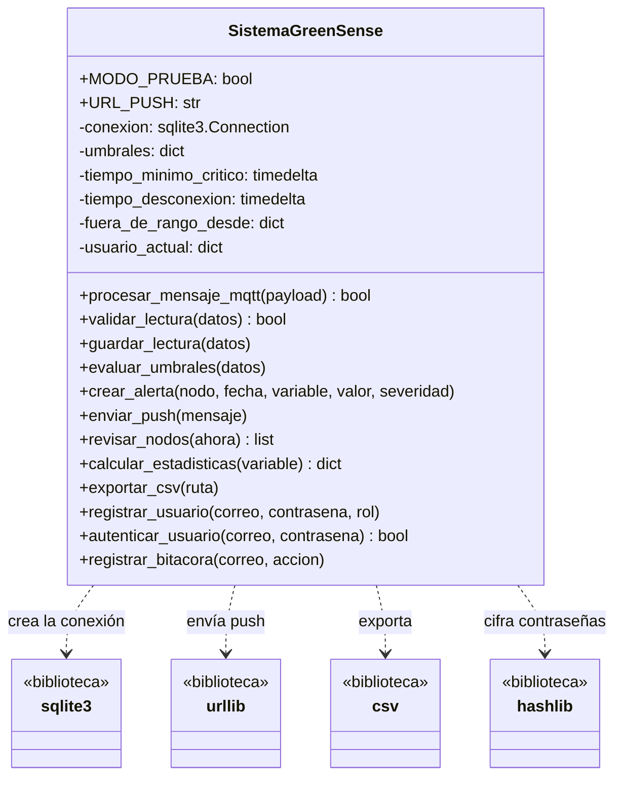

# Análisis del diseño original

El diseño original es la primera versión del servidor de GreenSense IoT: un prototipo rápido en el que toda la lógica quedó dentro de la clase `SistemaGreenSense` (`original/sistema_greensense.py`). Funciona y pasa sus pruebas, pero concentra demasiadas responsabilidades.

## 1. Responsabilidades de la clase

| Método | Responsabilidad | Motivo de cambio |
|---|---|---|
| `__init__`, `_crear_tablas` | Abrir la base de datos y crear las tablas | Cambio de motor de base de datos o del esquema |
| `procesar_mensaje_mqtt` | Interpretar el mensaje y coordinar el flujo | Cambio en el formato del mensaje o en el protocolo |
| `validar_lectura` | Descartar lecturas incompletas o imposibles | Cambio en los límites físicos o en los campos |
| `guardar_lectura` | Escribir lecturas y estado del nodo con SQL | Cambio de motor de base de datos o del esquema |
| `evaluar_umbrales` | Decidir advertencia o crítica, con tiempo mínimo | Cambio en las reglas agronómicas o en las variables |
| `crear_alerta` | Guardar la alerta y decidir si notificar | Cambio en el modelo de alertas |
| `enviar_push` | Enviar la notificación por HTTP | Cambio de proveedor o canal de notificación |
| `revisar_nodos` | Detectar nodos desconectados y avisar | Cambio en la política de conexión |
| `calcular_estadisticas` | Obtener mínimo, máximo y promedio | Cambio en los reportes |
| `exportar_csv` | Generar el archivo y validar el permiso | Cambio en el formato del reporte o en los permisos |
| `registrar_usuario`, `autenticar_usuario` | Cifrar contraseñas e iniciar sesión | Cambio en la política de seguridad |
| `registrar_bitacora` | Registrar acciones de los usuarios | Cambio en la auditoría |

Una sola clase tiene al menos **seis motivos de cambio distintos**: protocolo de mensajes, base de datos, reglas del cultivo, notificaciones, reportes y seguridad. Cada uno corresponde a una necesidad o a un actor diferente.

## 2. Problemas encontrados

### Código difícil de mantener
La clase mide más de 250 líneas y mezcla SQL, reglas del negocio, red y seguridad. Para cambiar una regla de umbral hay que leer código que no tiene relación con ella.

### Duplicación de código
- `evaluar_umbrales` repite el mismo bloque de comparación tres veces, uno por variable. Corregir un error en la lógica obliga a corregirlo en tres lugares.
- `calcular_estadisticas` repite la misma consulta SQL tres veces.
- El cifrado de contraseñas está escrito dos veces, en `registrar_usuario` y en `autenticar_usuario`.

### Dependencia excesiva entre componentes
- El constructor abre directamente una conexión a SQLite. No es posible usar otra base de datos sin modificar la clase.
- `enviar_push` está atado a una URL y a `urllib`. Las reglas de umbral dependen indirectamente del servicio push.
- `exportar_csv` depende del estado `usuario_actual`, que pertenece a la parte de autenticación.

### Dificultad para realizar modificaciones
- Agregar una variable nueva, como la luminosidad, obliga a copiar otro bloque en `evaluar_umbrales` y otra rama en `calcular_estadisticas`.
- Agregar un canal de aviso, como el correo, obliga a modificar `crear_alerta` y `revisar_nodos`.
- La bandera `MODO_PRUEBA` mezcla código de prueba con código de producción.

### Error de confiabilidad causado por el diseño
En `crear_alerta`, la notificación se envía **antes** de confirmar la alerta en la base de datos. Si el servicio push falla, la excepción interrumpe el proceso y la alerta crítica se pierde. Esto incumple el requisito RNF7. La prueba `test_si_falla_el_push_se_pierde_la_alerta` lo demuestra, y para lograrlo tiene que reemplazar un método interno de la clase.

### Dificultad para probar
Todas las pruebas del original necesitan crear una base de datos real, porque la clase la abre en su constructor. No hay forma de probar las reglas de umbral por separado. Esto incumple el requisito RNF6.

## 3. Diagnóstico con los principios SOLID

| Principio | Diagnóstico |
|---|---|
| **S** Responsabilidad única | Se incumple. La clase tiene al menos seis motivos de cambio. |
| **O** Abierto/cerrado | Se incumple. Las variables y los canales se manejan con bloques repetidos y condicionales; cada variante nueva obliga a editar código ya probado. |
| **L** Sustitución de Liskov | No aplica todavía, porque no hay herencia ni implementaciones intercambiables. Se vuelve relevante en el diseño mejorado, donde varias implementaciones deben respetar el mismo contrato. |
| **I** Segregación de interfaces | Se incumple. Cualquier código que solo necesite exportar un CSV depende de una clase que también maneja MQTT, alertas y notificaciones. |
| **D** Inversión de dependencias | Se incumple. La lógica de alto nivel crea y usa directamente SQLite y `urllib` en lugar de depender de abstracciones. |

## 4. Cohesión y acoplamiento

- **Cohesión baja:** los métodos de la clase atienden propósitos sin relación entre sí, como cifrar contraseñas y evaluar la humedad del sustrato.
- **Acoplamiento alto:** las reglas del negocio dependen de detalles de infraestructura (SQL, HTTP y el formato del mensaje).

## 5. Diagrama de clases del diseño original

El diagrama muestra una sola clase con dependencias directas a cuatro bibliotecas de infraestructura. No hay interfaces ni separación entre reglas del negocio e infraestructura.
