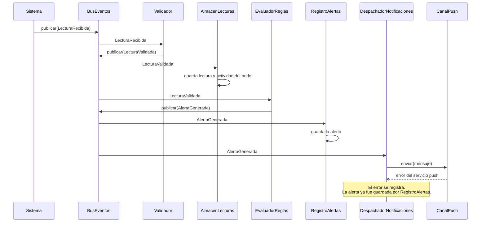

# Diagramas de la versión de eventos y estrategias

## Diagrama de clases

```mermaid
classDiagram
    direction TB

    class BusEventos {
        -suscriptores: dict
        +errores: list
        +suscribir(tipo, manejador)
        +publicar(evento)
    }

    class LecturaRecibida {
        +datos: dict
    }
    class LecturaValidada {
        +lectura: Lectura
    }
    class AlertaGenerada {
        +alerta: Alerta
    }
    class NodoDesconectado {
        +nodo: str
        +fecha: datetime
    }

    class Validador {
        +manejar(LecturaRecibida)
    }
    class AlmacenLecturas {
        +manejar(LecturaValidada)
    }
    class EvaluadorReglas {
        -reglas: list
        +manejar(LecturaValidada)
    }
    class RegistroAlertas {
        +manejar(AlertaGenerada)
    }
    class DespachadorNotificaciones {
        -canales: list
        +al_generar_alerta(AlertaGenerada)
        +al_desconectar_nodo(NodoDesconectado)
    }
    class MonitorNodos {
        +revisar(ahora) list
    }

    class ReglaUmbral {
        <<interface>>
        +evaluar(lectura) Alerta
    }
    class ReglaRango
    class CanalNotificacion {
        <<interface>>
        +enviar(mensaje)
    }
    class CanalPush
    class CanalConsola

    class RepositorioLecturas {
        <<interface>>
    }
    class RepositorioAlertas {
        <<interface>>
    }
    class RepositorioNodos {
        <<interface>>
    }

    ReglaUmbral <|.. ReglaRango
    CanalNotificacion <|.. CanalPush
    CanalNotificacion <|.. CanalConsola
    EvaluadorReglas o-- ReglaUmbral
    DespachadorNotificaciones o-- CanalNotificacion

    Validador ..> BusEventos : publica LecturaValidada
    EvaluadorReglas ..> BusEventos : publica AlertaGenerada
    MonitorNodos ..> BusEventos : publica NodoDesconectado
    AlmacenLecturas --> RepositorioLecturas
    AlmacenLecturas --> RepositorioNodos
    RegistroAlertas --> RepositorioAlertas
    MonitorNodos --> RepositorioNodos

    Validador ..> LecturaRecibida : escucha
    AlmacenLecturas ..> LecturaValidada : escucha
    EvaluadorReglas ..> LecturaValidada : escucha
    RegistroAlertas ..> AlertaGenerada : escucha
    DespachadorNotificaciones ..> AlertaGenerada : escucha
    DespachadorNotificaciones ..> NodoDesconectado : escucha
```

Ningún manejador conoce a otro manejador. Todos se comunican mediante el bus.

## Diagrama de secuencia: recorrido de un evento

