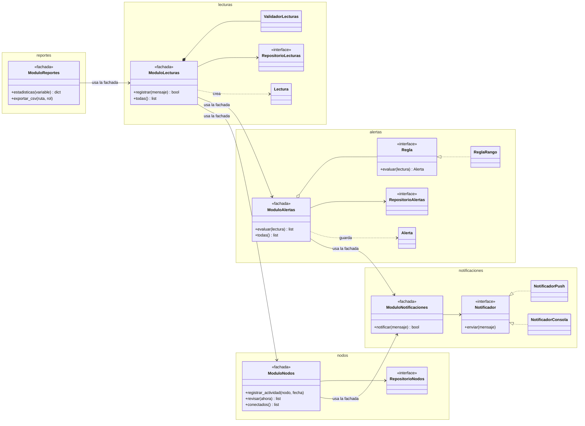
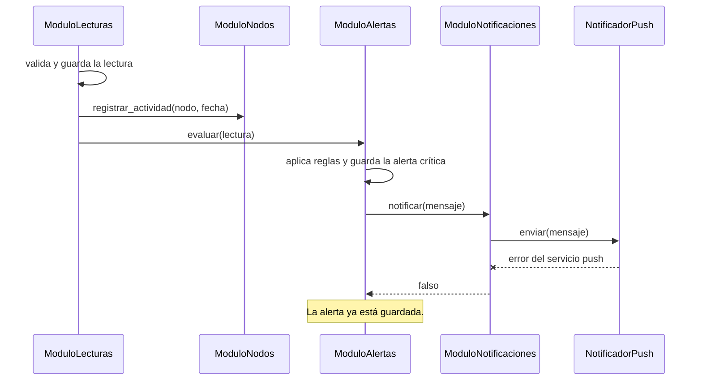

# Diagramas de la versión de módulos por funcionalidad

## Diagrama de clases

Las flechas entre módulos siempre llegan a una fachada. Ningún módulo usa las clases internas de otro.

## Diagrama de secuencia: llega una lectura fuera de rango

