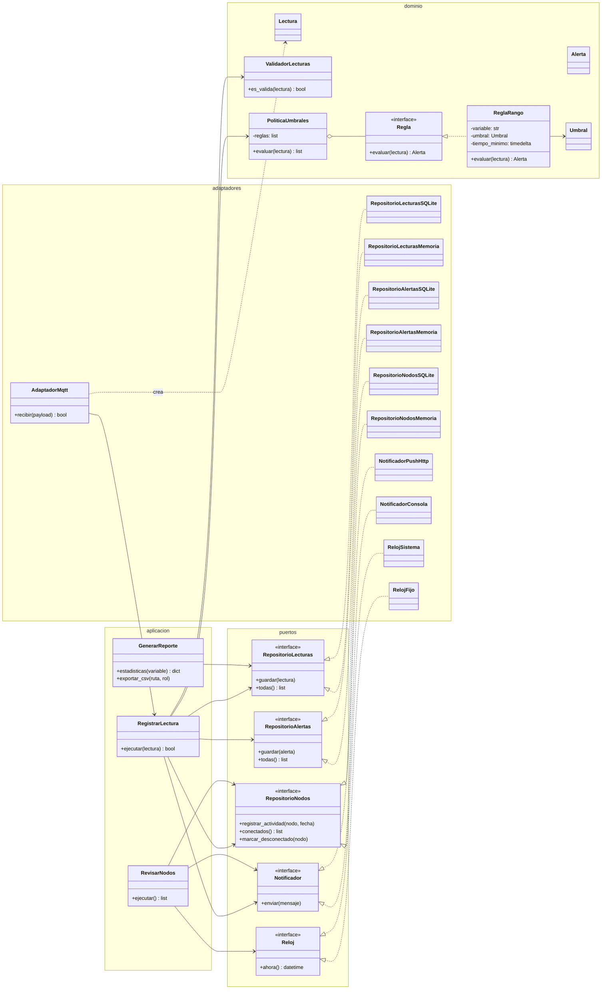
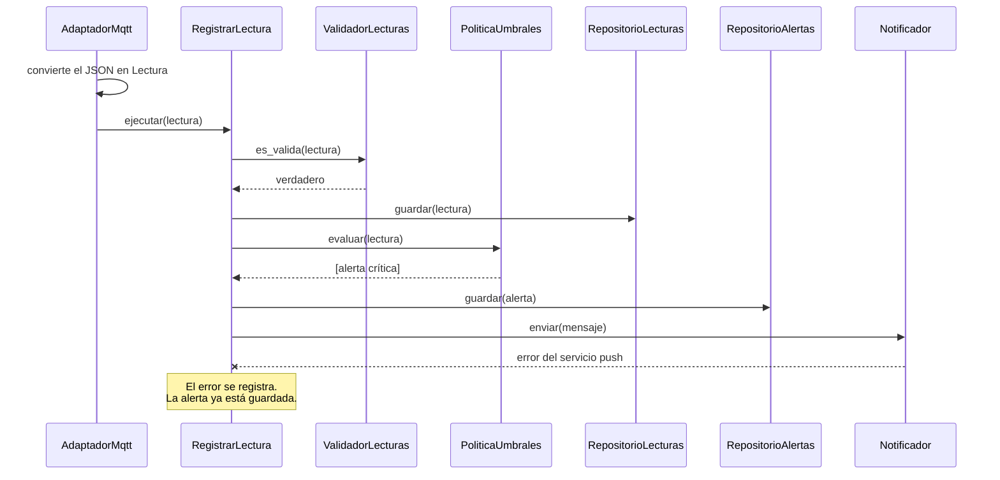

# Diagramas de la versión de puertos y adaptadores

## Diagrama de clases

Todas las flechas de dependencia apuntan hacia el núcleo (dominio y puertos). Los adaptadores conocen al núcleo, pero el núcleo no conoce a ningún adaptador.

## Diagrama de secuencia: llega una lectura fuera de rango

